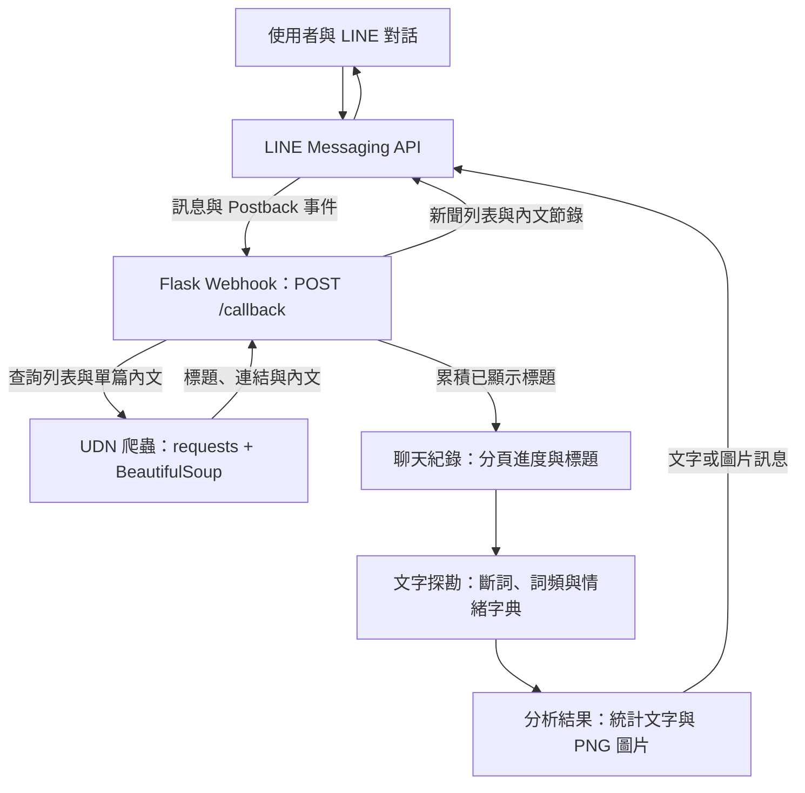

<div align="center">

# 📰 LINE 新聞內容助理

### `linebot_openai` · 新聞查詢與文字探勘

在 LINE 對話中瀏覽新聞、查看摘要，並以詞頻圖、文字雲與情緒統計整理閱讀內容。

[](https://www.python.org/)
[](https://flask.palletsprojects.com/)
[](https://developers.line.biz/)
[](https://github.com/fxsjy/jieba)

[🎥 觀看 Demo](https://www.youtube.com/shorts/LarI_PSKSY8) · [💻 專案原始碼](https://github.com/johnnychan0523/linebot_openai)

</div>

---

## 📌 專案簡介

本專案以 **LINE Messaging API** 作為互動介面，透過 **Flask Webhook** 接收使用者訊息，搭配 `requests` 與 `BeautifulSoup` 取得 UDN 聯合新聞網的新聞資料。

使用者可以選擇 **運動、全球、股市、社會、產經** 五類新聞，每次閱讀最多 5 則標題與原文連結，再針對累積的標題進行中文斷詞、詞頻統計與情緒分析。需要查看單篇內容時，也能輸入類別與新聞編號，取得內文節錄。

專案著重於新聞資料擷取、LINE 事件處理與文字探勘的整合，讓新聞閱讀與分析都能在同一個聊天介面完成。

## 🎥 Demo 影片

**[▶️ 點擊觀看專案 Demo（YouTube Shorts）](https://www.youtube.com/shorts/LarI_PSKSY8)**

影片連結：https://www.youtube.com/shorts/LarI_PSKSY8

---

## ✨ 主要功能

| 功能 | 說明 |
| --- | --- |
| 📰 五類新聞查詢 | 透過 Quick Reply 按鈕選擇運動、全球、股市、社會或產經新聞，回傳標題與原文連結 |
| 📑 分頁閱讀 | 每次最多 5 則；同一聊天再次點選同一類別時，接續顯示下一頁 |
| ✂️ 單篇新聞摘要 | 指定類別與編號，擷取新聞內文前 160 個字元，附上標題與原文連結 |
| 📊 詞頻長條圖 | 使用 `jieba` 處理已累積的新聞標題，統計前 15 個高頻詞並繪製橫向長條圖 |
| ☁️ 中文文字雲 | 以全部已累積標題或指定類別的標題產生文字雲，直接回傳 LINE 圖片訊息 |
| 🙂 情緒分析 | 依自訂正向、負向詞彙判斷標題傾向，提供正向、負向與中立的則數 |
| 🔎 跨類別比較 | 輸入「情緒分析」後，列出已有閱讀紀錄的各類新聞情緒統計 |
| 🔄 閱讀紀錄重置 | 支援清空全部紀錄，或重新開始指定類別的閱讀進度 |
| 👋 歡迎訊息 | 加好友時介紹功能與新聞選單；群組新成員加入時發送歡迎訊息 |

### 新聞類別與可辨識關鍵字

| 新聞類別 | 可辨識的文字 | 資料來源 |
| --- | --- | --- |
| 運動 | 運動、體育 | [UDN 運動新聞](https://udn.com/news/cate/2/7227) |
| 全球 | 全球、國際 | [UDN 全球新聞](https://udn.com/news/cate/2/7225) |
| 股市 | 股市、股票 | [UDN 股市新聞](https://udn.com/news/cate/2/6645) |
| 社會 | 社會 | [UDN 社會新聞](https://udn.com/news/cate/2/6639) |
| 產經 | 產經、財經、經濟 | [UDN 產經新聞](https://udn.com/news/cate/2/6644) |

這些關鍵字用於摘要、文字雲、情緒分析與重置指令中的類別辨識。**查詢新聞列表時，請先開啟選單，再點選類別按鈕。**

## 💬 操作方式

### 常用指令

| 操作目的 | 輸入或操作 | 回覆內容 |
| --- | --- | --- |
| 開啟新聞選單 | `我想看新聞` | 顯示五個新聞類別的 Quick Reply 按鈕 |
| 閱讀新聞 | 點選 `股市新聞` 等類別按鈕 | 回傳該類別本頁的新聞標題與連結 |
| 接續下一頁 | 再輸入 `我想看新聞`，並點選同一類別 | 依序顯示第 6～10 則、第 11～15 則等內容 |
| 查看單篇摘要 | `股市新聞第3則摘要` | 第 3 則股市新聞的內文節錄與原文連結 |
| 使用中文編號 | `運動新聞第十則摘要` | 第 10 則運動新聞的內文節錄 |
| 分析全部已讀標題 | `文字雲` | 詞頻長條圖與文字雲圖片 |
| 分析指定類別標題 | `股市文字雲` | 已累積股市標題的詞頻長條圖與文字雲 |
| 比較各類別情緒 | `情緒分析` | 各類別的正向、負向、中立則數與整體傾向 |
| 查看單一類別情緒 | `運動情緒分析` | 運動新聞的標題總數、情緒則數與整體傾向 |
| 清空全部閱讀紀錄 | `清空紀錄` 或 `重新開始` | 清除該聊天的分頁進度與標題統計 |
| 重置指定類別 | `股市重新開始` | 重置股市閱讀進度與該類別標題，同時清空整體標題彙總 |
| 感謝回覆 | `謝謝`、`感謝`、`thank you`、`thx` | 回傳感謝回應 |

**摘要指令格式：** 使用「類別＋第X則＋摘要」，例如 `股市新聞第3則摘要`。目前解析規則要求 `第`、數字與 `則` 連在一起，請勿寫成 `第 3 則`。

文字雲與情緒分析使用的是**已透過新聞按鈕顯示並累積的標題**。尚未查詢新聞時，機器人會提示先閱讀新聞。

### 建議操作流程

1. 將 LINE 官方帳號加為好友，或傳送 `我想看新聞`。
2. 點選一個新聞類別，閱讀標題與原文連結。
3. 再次開啟選單並點選同類別，繼續累積新聞標題。
4. 輸入 `股市新聞第3則摘要` 等指令，查看指定新聞的內文節錄。
5. 輸入 `文字雲` 或 `股市文字雲`，取得詞頻圖與文字雲。
6. 輸入 `情緒分析` 或 `股市情緒分析`，查看標題情緒統計。

### 範例對話

以下為操作示意，實際新聞內容與統計結果依查詢時的資料而定。

```text
使用者：我想看新聞
機器人：請選擇想看的新聞類別：
        [運動新聞] [全球新聞] [股市新聞] [社會新聞] [產經新聞]

使用者：（點選「股市新聞」）
機器人：股市新聞 第1 則
        （新聞標題）
        （原文連結）
        ……本頁最多 5 則

使用者：股市新聞第3則摘要
機器人：【股市新聞 第3則摘要】
        （新聞標題）
        （內文前 160 個字元，較長內容附上省略號）
        原文連結：（新聞網址）

使用者：股市文字雲
機器人：（詞頻長條圖）
        （文字雲圖片）

使用者：股市情緒分析
機器人：【股市新聞 情緒分析】
        目前已累積標題數：（則數）
        🙂 正向：（則數）
        ☹️ 負向：（則數）
        😐 中立：（則數）
        ➡️ 整體（情緒傾向）
```

---

## 🗺️ 系統架構



`/callback` 會讀取 `X-Line-Signature` 並交由 `WebhookHandler` 驗證，再分派至加好友、文字訊息、Postback 與群組成員加入事件的處理函式。

## 📊 文字探勘方法

### 詞頻圖與文字雲

以已顯示的新聞標題作為分析資料，使用 `jieba` 斷詞並保留去除前後空白後長度至少為 2 的詞。`Counter` 統計詞頻後，`matplotlib` 繪製前 15 個高頻詞的橫向長條圖，`wordcloud` 產生 800 × 600 的白底文字雲。

兩張圖片皆使用專案內的 `msjh.ttc` 顯示中文，儲存於 `static/tmp/`，再透過 LINE 圖片訊息回傳。

### 規則式情緒分析

每則標題會與 `POSITIVE_WORDS`、`NEGATIVE_WORDS` 比對：每個命中的正向詞加 1 分，每個命中的負向詞減 1 分。

| 標題分數 | 分類 |
| --- | --- |
| 大於 0 | 🙂 正向 |
| 小於 0 | ☹️ 負向 |
| 等於 0 | 😐 中立 |

各類別的整體傾向由**則數最多的分類**決定；若最高則數並列，回覆「都差不多」。這是標題用詞的規則式統計，結果受字典範圍、詞彙重疊與語境影響。

### 新聞摘要

摘要功能會重新取得該類別的新聞列表，依編號讀取單篇內文，擷取前 160 個字元；若內文較長，再附上省略號。編號以**該次取得的完整類別列表**為準，新聞更新後的排序可能與先前閱讀時不同。

目前版本以內文截取與情緒字典實作。儲存庫沿用 `linebot_openai` 名稱，**尚未整合 OpenAI API，也不需要 `OPENAI_API_KEY`**。

## 🛠️ 使用技術

| 類別 | 技術 | 用途 |
| --- | --- | --- |
| 程式語言 | Python 3 | Webhook、爬蟲與文字處理 |
| 後端框架 | Flask | 接收 LINE 事件、提供圖片檔案 |
| 聊天機器人 | LINE Messaging API、`line-bot-sdk` | Quick Reply、Postback、文字與圖片回覆 |
| 網頁擷取 | `requests`、`beautifulsoup4` | 取得 UDN 新聞列表與文章內文 |
| 中文處理 | `jieba`、`collections.Counter` | 中文斷詞與詞頻統計 |
| 資料視覺化 | `matplotlib`、`wordcloud` | 詞頻長條圖與文字雲 |
| 中文字型 | `msjh.ttc` | 圖片中文字顯示 |
| 服務執行 | Gunicorn | Linux 伺服器上的 WSGI 服務 |

## 📁 專案結構

| 路徑 | 說明 |
| --- | --- |
| [app.py](app.py) | Flask 主程式，包含 LINE 事件處理、新聞爬蟲、摘要、文字雲與情緒分析 |
| [requirements.txt](requirements.txt) | Python 套件相依清單 |
| [msjh.ttc](msjh.ttc) | 圖表與文字雲使用的中文字型檔 |
| [README.md](README.md) | 專案介紹、Demo 與操作說明 |
| `static/tmp/` | 執行文字雲功能時自動建立，存放產生的 PNG 圖片 |

---

## 🚀 安裝與執行

### 1. 取得專案並安裝套件

```bash
git clone https://github.com/johnnychan0523/linebot_openai.git
cd linebot_openai
python -m venv .venv
```

啟用虛擬環境：

```bash
# macOS / Linux
source .venv/bin/activate
```

```powershell
# Windows PowerShell
.\.venv\Scripts\Activate.ps1
```

```bash
python -m pip install -r requirements.txt
```

`requirements.txt` 尚未固定版本，程式使用 `from linebot import LineBotApi, WebhookHandler` 等既有 SDK 介面。LINE SDK 3.x 保留這些介面，但已標示棄用；相關說明可參考 [官方 SDK 文件](https://github.com/line/line-bot-sdk-python#version-3x)。

### 2. 設定 LINE 與環境變數

建立 LINE 官方帳號並啟用 Messaging API，再至 LINE Developers Console 取得該 Channel 的存取權杖與 Secret。建立步驟請參考 [LINE 官方說明](https://developers.line.biz/en/docs/messaging-api/getting-started/)。

| 變數名稱 | 必填 | 用途 |
| --- | --- | --- |
| `CHANNEL_ACCESS_TOKEN` | 是 | LINE Messaging API 存取權杖 |
| `CHANNEL_SECRET` | 是 | LINE Webhook 簽章驗證 |
| `PORT` | 否 | `python app.py` 的監聽埠，預設 `5000` |

```bash
# macOS / Linux：請替換成自己的 Channel 資料
export CHANNEL_ACCESS_TOKEN="YOUR_CHANNEL_ACCESS_TOKEN"
export CHANNEL_SECRET="YOUR_CHANNEL_SECRET"
export PORT="5000"
```

```powershell
# Windows PowerShell：請替換成自己的 Channel 資料
$env:CHANNEL_ACCESS_TOKEN="YOUR_CHANNEL_ACCESS_TOKEN"
$env:CHANNEL_SECRET="YOUR_CHANNEL_SECRET"
$env:PORT="5000"
```

程式直接讀取系統環境變數，未自行載入 `.env` 檔案。部署時請在平台的環境變數設定中填入對應值。

### 3. 啟動服務

本機開發：

```bash
python app.py
```

預設監聽 `0.0.0.0:5000`，Webhook 端點為 **`POST /callback`**。

Linux 伺服器可使用 Gunicorn：

```bash
gunicorn --workers 1 --bind "0.0.0.0:${PORT:-5000}" app:app
```

目前聊天紀錄保存在程式的記憶體字典中，因此以上範例使用單一 worker。服務重新啟動後，閱讀進度與標題紀錄會清空；多個 worker 或多個實例不會共享紀錄。

### 4. 設定 Webhook 與圖片網址

1. 將服務部署至具有公開 **HTTPS** 網址的主機，或使用 HTTPS 通道連接本機服務。
2. 在 LINE Developers Console 的 Messaging API 設定中，將 Webhook URL 設為 `https://YOUR_DOMAIN/callback`。
3. 執行 **Verify**，確認成功後開啟 **Use webhook**。
4. 若歡迎訊息與回覆由程式處理，可在 LINE Official Account Manager 關閉預設歡迎訊息與自動回應，避免重複回覆。
5. 將帳號加為好友，傳送 `我想看新聞` 並點選類別按鈕。

圖片網址由 `request.url_root` 建立。請確認 `/static/tmp/產生的檔名.png` 可由外部透過 HTTPS 存取，且執行環境允許寫入 `static/tmp/`。若使用反向代理，需確認 Flask 取得的協定與網域正確。

Webhook 與圖片訊息的網址要求可參考 [建立 Bot](https://developers.line.biz/en/docs/messaging-api/building-bot/) 與 [LINE Messaging API 參考文件](https://developers.line.biz/en/reference/messaging-api/#image-message)。

## 🧩 使用注意事項

| 情況 | 目前行為或確認方式 |
| --- | --- |
| 未閱讀新聞就要求分析 | 先開啟選單並點選新聞類別；分析資料來自已顯示的標題 |
| 指定類別重置 | 清除該類別標題並重置分頁，同時清空整體文字雲使用的 `all` 彙總；其他類別的獨立標題仍保留 |
| 某類別已無下一頁 | 回覆提示、將該類別頁碼設回第 1 頁，並清除該聊天的全部標題統計；下次點選再查詢 |
| 標題重複出現 | 目前未去除重複標題，重複顯示的標題可能重複計入分析 |
| 新聞列表或內文讀取失敗 | 檢查外部連線及 UDN 頁面結構；爬蟲依賴 CSS 選擇器與頁面內容 |
| 文字雲或中文圖表未顯示 | 檢查 `msjh.ttc` 是否存在、目錄能否寫入，以及圖片網址是否為公開 HTTPS |
| Webhook 無法正常使用 | 檢查 Channel 環境變數、`/callback` 路徑、Use webhook 與伺服器日誌 |

聊天紀錄依個人、群組或多人聊天室的來源 ID 分開保存。群組內使用者共用該群組的閱讀進度與標題統計。

## 🔮 後續可擴充方向

- 使用資料庫或 Redis 保存聊天狀態，支援重新啟動與多實例部署。
- 快取新聞列表、去除重複標題，並保留查詢時的新聞編號對應。
- 擴充停用詞與情緒字典，改善關鍵詞品質及語境判斷。
- 整合語意摘要或情緒分類模型，提升內文整理與分析能力。
- 加入暫存圖片清理機制，管理 `static/tmp/` 的檔案數量。

---

專案維護：[johnnychan0523](https://github.com/johnnychan0523)
